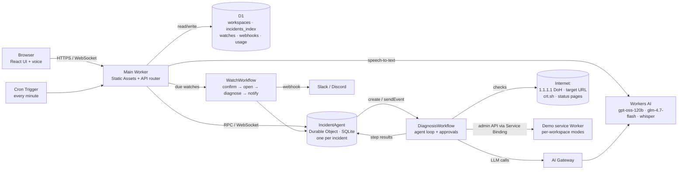
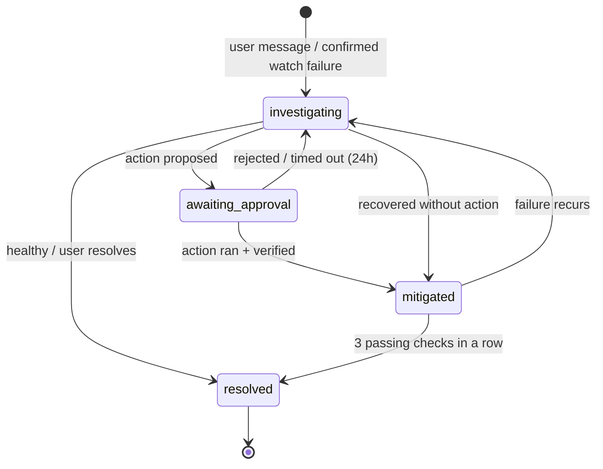

# Incident Copilot — Product Requirements Document

| | |
|---|---|
| **Product** | Incident Copilot |
| **Repository** | `cf_ai_incident_copilot` |
| **Status** | Draft v1, approved for build |
| **Date** | 2026-10-14 |
| **Target** | ~1 week build (milestones M1–M5) |
| **Platform** | Cloudflare Workers, Workflows, Durable Objects (Agents SDK), D1, Workers AI, AI Gateway |

---

## 1. Overview

Incident Copilot is an AI on-call assistant that runs on Cloudflare. An engineer describes a symptom in chat or by voice, for example "api.example.com is slow" or "checkout.example.com is throwing errors". An AI agent decides which diagnostics to run, runs them as durable, retryable workflow steps, and explains in plain English what is wrong, citing the evidence. It then proposes a next step, which runs only after the engineer approves it.

It can also watch a few endpoints on a schedule. When a watched endpoint fails, it confirms the failure, opens an incident, investigates on its own and notifies the engineer. The diagnosis is already waiting when they arrive.

**Target user:** one engineer debugging a public endpoint they're responsible for.

**Job to be done:**
> *"Tell me in plain English why this endpoint is unhealthy, show me the evidence, and suggest the next step."*

**Why this product:** first-response triage of an unhealthy endpoint is repetitive, manual work that people have learned to live with: run `dig`, run `curl -v`, check the cert, check the provider's status page, then piece it together. That's an operational problem that can be solved with software, and it's a natural fit for Cloudflare's network, its 1.1.1.1 resolver and durable workflows.

---

## 2. Goals and non-goals

### Goals
- G1. Go from a chat message to an evidence-backed diagnosis in **under 30 seconds**.
- G2. Make every claim in a diagnosis **traceable to evidence** from a check.
- G3. Demonstrate the **full self-healing loop**: detect → confirm → diagnose → approve → fix → verify → resolve.
- G4. Keep the product **safe to expose publicly** (no SSRF, no open proxy, no runaway costs).
- G5. Run **within the Workers AI free allocation** for normal reviewer traffic, and degrade gracefully when it runs out.
- G6. Treat it as production engineering: tests, CI/CD, Infrastructure as Code, and an eval suite for the AI's behavior.

### Non-goals (v1)
- User accounts, logins, teams, roles or a shared on-call rotation.
- Fixing infrastructure the user doesn't own (no third-party API tokens, no changes to real zones).
- Probes from several regions, ping/ICMP, traceroute, or raw TCP/TLS handshake inspection.
- Email/SMS/PagerDuty notifications (only Slack/Discord webhooks).
- Mobile-optimized layout beyond "not broken", theming, or i18n.
- Long-term metrics storage or dashboards.

---

## 3. Assignment requirement mapping

| # | Requirement | Implementation | Why this choice |
|---|---|---|---|
| 1 | **LLM** | Workers AI `@cf/openai/gpt-oss-120b` (primary), `@cf/zai-org/glm-4.7-flash` (fallback), routed through **AI Gateway** | Strong tool calling and reasoning within the free allocation. The gateway adds fallback, logs, caching and rate limits. |
| 2 | **Workflow / coordination** | **Workflows**: `DiagnosisWorkflow` (agent loop, approvals) and `WatchWorkflow` (confirm → open → diagnose → notify) | Each LLM call and each check is a durable, retryable step. `waitForEvent` provides human approval with a timeout. |
| 3 | **User input via chat or voice** | React chat UI served by **Workers Static Assets** (Cloudflare's recommended successor to Pages), plus push-to-talk voice through Workers AI `whisper-large-v3-turbo` | One deploy and one URL. The WebSocket connects directly to the incident's Durable Object. |
| 4 | **Memory or state** | **Durable Objects** (Agents SDK `Agent`, one per incident, SQLite storage) and **D1** (incident index, watchlist job table, webhooks) | One actor per incident gives isolation and live updates. D1 is good at "which watches are due now?" queries. |

**Extra Cloudflare products:** AI Gateway, Cron Triggers, D1, Rate Limiting binding, Workers Static Assets, Workers AI speech-to-text, Service Bindings (demo service).

---

## 4. User stories and key flows

### 4.1 Diagnose on demand (core)
> As an engineer, I type "api.example.com returns 502s since 10am" and get a diagnosis with evidence in under 30 seconds.

1. The user sends a message. The incident `Agent` creates an incident and starts a `DiagnosisWorkflow`.
2. The LLM plans which checks to run (e.g. `http_probe`, then `dns_lookup`, then `provider_status`).
3. Each check appears as a **check card** that updates live: pending → running → pass or fail, with expandable evidence.
4. The LLM writes the diagnosis: likely cause, confidence, evidence references (`[http-1]`, `[dns-1]`), and suggested next steps.
5. If an action fits, it appears as an **approval card**.

### 4.2 Break the demo → diagnose → approve the fix (the reviewer demo)
> As a reviewer, I break the demo service, ask the copilot what's wrong, approve its fix, and watch the service recover.

1. In the **Demo service** panel, the user flips "500 errors" on.
2. The user asks: "What's wrong with my demo service?"
3. The agent probes it, finds the 500s, and proposes "Restore demo service to healthy mode".
4. The user clicks **Approve**. The waiting Workflow resumes, calls the demo service's admin API through a Service Binding, and re-probes.
5. The incident moves to `mitigated` and then auto-resolves after 3 passing checks.

### 4.3 Watch → auto-incident → notify → resolve
> As an engineer, I add an endpoint to my watchlist and get notified, with a diagnosis ready, when it breaks.

1. The user says "watch api.example.com every 5 minutes", or uses the approval action "Add to watchlist".
2. The Cron Trigger (every minute) finds due watches in D1 and runs a quick check (HTTP + DNS, no LLM).
3. On failure, `WatchWorkflow` re-checks twice, 30 seconds apart. **2 of 3 failures** confirm it.
4. An incident opens automatically and the agent diagnosis runs.
5. Notifications: an unread badge in the app, a browser notification (if a tab is open), and the Slack/Discord webhook if configured.
6. The incident auto-resolves after 3 passing checks in a row, which sends a webhook "resolved" message.

### 4.4 Voice query
> As an engineer on the move, I hold the mic button and say "is checkout dot example dot com down?"

1. Push-to-talk records audio in the browser (MediaRecorder).
2. The audio is uploaded to the Worker and transcribed by `whisper-large-v3-turbo`.
3. The transcript fills the input box. **The user confirms or edits it before sending**, because spoken hostnames are easily misheard.

### 4.5 Postmortem
> As an engineer, after resolving an incident, I click "Postmortem" and get a markdown write-up to paste into our docs.

Generated from the incident timeline: summary, impact window, detection, timeline, root cause (with evidence), resolution, follow-ups.

---

## 5. Functional requirements

Priority: **Must** (needed to submit) · **Should** (planned for the 1-week scope) · **Could** (stretch)

### 5.1 Chat and incidents
| ID | Requirement | Priority |
|---|---|---|
| FR-1 | The user can start a new diagnosis from a chat message naming a hostname or URL. | Must |
| FR-2 | Each diagnosis belongs to an **incident** with an unguessable ID; the incident URL reopens the full chat, evidence and timeline. | Must |
| FR-3 | Assistant replies stream to the UI as they're generated. | Must |
| FR-4 | Check cards update live over WebSocket (pending/running/pass/fail) with expandable raw evidence. | Must |
| FR-5 | Follow-up questions in an incident use the existing evidence and can trigger targeted re-checks. | Must |
| FR-6 | A sidebar lists incidents for the workspace (open/resolved, unread badge). | Should |
| FR-7 | The user can resolve an incident manually. | Should |
| FR-8 | Workspace identity is an anonymous, HttpOnly cookie; no sign-in. | Must |

### 5.2 Agent and tools
| ID | Requirement | Priority |
|---|---|---|
| FR-10 | The LLM acts as a planner, choosing tools through function calling. | Must |
| FR-11 | Tools: `dns_lookup`, `http_probe`, `cert_info`, `provider_status` (see §6.1). | Must (cert_info, provider_status: Should) |
| FR-12 | At most **6 tool calls** per diagnosis turn; schema-validated arguments; invalid calls are rejected and reported back to the model once. | Must |
| FR-13 | Each LLM call and each tool call is a separate durable `step.do` with retries. | Must |
| FR-14 | **Deterministic fallback:** if the model errors, loops or exceeds bounds, run all four checks and produce a rule-based summary. | Must |
| FR-15 | Every factual claim in a diagnosis cites at least one evidence ID; the UI links references to check cards. | Must |
| FR-16 | The diagnosis is classified into a failure category (§6.4) and includes a confidence level (high/medium/low). | Should |

### 5.3 Actions and approvals
| ID | Requirement | Priority |
|---|---|---|
| FR-20 | The agent may only **propose** actions; nothing runs without a human Approve click. | Must |
| FR-21 | Approval is implemented with Workflows `waitForEvent`, with a **24-hour timeout** that records "no action taken". | Must |
| FR-22 | Action catalog: `restore_demo_service` (demo target only), `add_to_watchlist`, `recheck_burst` (every minute for 15 minutes), `generate_postmortem`. | Must (restore_demo, add_to_watchlist); Should (rest) |
| FR-23 | After an action, the Workflow re-verifies with fresh checks and records the outcome on the timeline. | Must |
| FR-24 | No action can target infrastructure outside the app's own control. | Must |

### 5.4 Demo service
| ID | Requirement | Priority |
|---|---|---|
| FR-30 | A separate small Worker serves a demo endpoint with modes: `healthy`, `slow` (+3 s), `errors` (HTTP 500), `redirect_loop`, `bad_cache` (`Cache-Control: no-store` on static assets plus `Set-Cookie` on every response). | Must |
| FR-31 | Demo state is **per workspace** (path `/w/<workspaceId>/`), so reviewers don't interfere with each other. | Must |
| FR-32 | The mode can only be changed through an admin API reachable via **Service Binding**, never publicly. | Must |
| FR-33 | A "Break the demo service" panel in the UI toggles modes and shows the demo URL. | Must |

### 5.5 Watchlist and incident lifecycle
| ID | Requirement | Priority |
|---|---|---|
| FR-40 | The user can add, list and remove watches (at most 3 per workspace, at least 5 minutes apart, 24-hour expiry). | Should |
| FR-41 | A Cron Trigger every minute selects due watches from D1 and runs a quick check (HTTP + DNS, no LLM). | Should |
| FR-42 | Confirmation: re-check twice, 30 seconds apart; **2 of 3 failures** confirm an incident. | Should |
| FR-43 | A confirmed failure auto-opens an incident and runs the agent diagnosis. | Should |
| FR-44 | Incidents auto-resolve after **3 passing checks in a row**. | Should |
| FR-45 | State machine as defined in §8.1; every transition is written to the timeline. | Must |

### 5.6 Notifications
| ID | Requirement | Priority |
|---|---|---|
| FR-50 | In-app unread badge for incidents with new activity. | Should |
| FR-51 | Browser notification (Notification API) when a tab is open and permission is granted. | Could |
| FR-52 | Optional workspace webhook: Slack or Discord only, https, exact host allowlist (`hooks.slack.com`; `discord.com` / `discordapp.com` with path `/api/webhooks/`). | Should |
| FR-53 | Webhook URL encrypted at rest (AES-GCM, key from a Worker secret) and shown masked in the UI. | Should |
| FR-54 | Webhooks are sent from a retried Workflow step, **at most once per incident state change**, with a summary and the incident link. | Should |

### 5.7 Voice
| ID | Requirement | Priority |
|---|---|---|
| FR-60 | Push-to-talk button records up to 30 seconds of audio. | Should |
| FR-61 | Transcribed by Workers AI `whisper-large-v3-turbo`; the transcript is placed in the input for confirmation, never sent automatically. | Should |

### 5.8 Postmortem
| ID | Requirement | Priority |
|---|---|---|
| FR-70 | "Postmortem" on a resolved incident generates markdown (summary, impact window, detection, timeline, root cause with evidence, resolution, follow-ups). | Should |
| FR-71 | One-click copy; the postmortem is stored on the incident. | Should |

---

## 6. Agent design

### 6.1 Tools

| Tool | Arguments | Evidence returned | Notes |
|---|---|---|---|
| `dns_lookup` | `hostname`, `types` ⊆ {A, AAAA, CNAME, NS, MX, TXT} | Answers, TTLs and status (NOERROR/NXDOMAIN/SERVFAIL) from **1.1.1.1 DNS-over-HTTPS** and a second resolver (8.8.8.8 DoH); mismatch flag | Detects NXDOMAIN, propagation differences, missing AAAA, CNAME chains. Results also feed the SSRF guard. |
| `http_probe` | `url`, `method` ∈ {GET, HEAD} | 3 samples: status, time to first byte, total time; redirect hops (recorded, not followed beyond 5); selected headers (`server`, `cf-ray`, `cf-cache-status`, `cache-control`, `content-type`, `location`, `set-cookie` present?); first ≤ 16 KB of body as an **untrusted snippet** (≤ 500 chars shown to the LLM) | Distinguishes slow vs. flaky vs. down; detects redirect loops and cache misconfiguration. |
| `cert_info` | `hostname` | Most recent unexpired certificate(s) from certificate-transparency logs (crt.sh): issuer, not-before, not-after, days to expiry, SAN match | **Best effort**: CT logs show certificates that were issued, not necessarily the one being served. The UI labels it as such. **CPU-bounded:** query only unexpired, deduplicated certificates (`exclude=expired&deduplicate=Y`), stop reading after 256 KB, and parse at most 20 entries, since crt.sh can return megabytes of JSON for large domains and the free plan allows 10 ms CPU per step. |
| `provider_status` | `providers` ⊆ {cloudflare, github, aws} | Active incidents and components from public status pages | Answers "is it me or them?". |

Each tool result gets an evidence ID: `<tool>-<n>` (e.g. `http-2`).

### 6.2 Loop and bounds
- The loop runs inside `DiagnosisWorkflow`. Each LLM turn is `step.do("llm-turn-N")` and each tool call is `step.do("tool-<id>")`, retried with exponential backoff (3 attempts).
- Hard limits: **6 tool calls**, **4 LLM turns**, **60 s** total budget per diagnosis.
- **Subrequest budget: ≤ 40 outbound requests per diagnosis** (the Workers Free limit is 50 per Workflow run, and retries count too). Worst case is about 30: 4 LLM calls + ~6 DNS queries + ≤ 15 HTTP requests (3 samples × ≤ 5 redirect hops) + 1 crt.sh + 3 status pages. A per-run counter refuses further tool calls once the budget is reached and records this in the timeline.
- **CPU budget:** every step stays well under 10 ms CPU (the Free limit). Responses are read with byte caps, and evidence passed between steps is truncated (full evidence lives in the Durable Object).
- Arguments are validated against JSON schemas. On an invalid call, the error is returned to the model once; a second invalid call triggers the fallback.
- **Deterministic fallback (FR-14):** run all 4 checks, then apply rule-based classification (§6.4) and a template summary. The UI shows "AI unavailable, rule-based diagnosis".

### 6.3 Prompt rules
- The system prompt defines the role, tools, limits, the failure categories and the output format (cause, category, confidence, evidence references, next steps, proposed action IDs).
- **Every claim must cite an evidence ID.** Claims without evidence are rejected by a post-check that strips them or asks the model to fix them once.
- **Untrusted data:** response bodies and headers are wrapped in delimited `<untrusted>` blocks with an instruction never to follow instructions inside them. Only truncated snippets are included.
- The model can only **propose** action IDs from the catalog (FR-22). The Workflow validates them before showing an approval card.

### 6.4 Failure categories
`dns_failure` · `dns_mismatch` · `tls_expiry` · `origin_5xx` · `edge_error` (Cloudflare 52x) · `high_latency` · `redirect_loop` · `cache_misconfiguration` · `provider_outage` · `healthy` · `inconclusive`

### 6.5 Model routing
- Primary: `@cf/openai/gpt-oss-120b`. Fallback: `@cf/zai-org/glm-4.7-flash`. Both go through **AI Gateway** (fallback on errors or rate limits, request logs, caching of identical requests).
- **Budget guard:** both models draw on the same 10,000 neuron/day free allocation, so the model fallback doesn't help once it's used up. A daily usage counter (in D1) switches the app to **deterministic mode** at ~90% of the allocation and shows a banner. (Mitigation for review week: optionally enable Workers Paid.)
- **Protect the allocation during development:** local `wrangler dev` still calls the real Workers AI and uses up neurons. Tests use a scripted mock LLM, and a `LLM_MODE=mock` setting makes local UI work possible without real calls. Eval-suite runs (~5 diagnoses ≈ 3,000 neurons) are scheduled so they don't consume a day reviewers might use the app.

---

## 7. Architecture



| Component | Responsibility |
|---|---|
| **Main Worker** | Serves the React app (Static Assets), API routes, workspace cookie, rate limiting, voice transcription, cron handler. |
| **IncidentAgent** (Agents SDK `Agent`, DO) | Source of truth for one incident: messages, evidence, approvals, timeline, status. Broadcasts state to connected clients. Starts Workflows, forwards approval events, and streams follow-up answers. |
| **DiagnosisWorkflow** | Bounded agent loop (§6.2); writes each step result to the incident; `waitForEvent("approval", 24h)`; runs approved actions; re-verifies. |
| **WatchWorkflow** | Confirm 2 of 3 → open incident → start diagnosis → notify → monitor to auto-resolve. |
| **D1** | Incident index per workspace, watch job table, encrypted webhooks, daily LLM usage counter. |
| **Demo service Worker** | Public demo endpoint with per-workspace modes; admin API reachable only through a Service Binding. |
| **AI Gateway** | Model fallback, logging, caching, rate limits. |

**Streaming note:** Workflow steps return complete results, not streams, so check cards update per step. The narrative text (the final diagnosis and follow-up answers) is streamed by the `IncidentAgent` using the evidence gathered by the Workflow.

**Agents SDK note:** the `Agent` class is a Durable Object with built-in WebSocket handling (with hibernation), state sync to React hooks, and SQL storage. The README will explain this so the abstraction is transparent.

---

## 8. Data model

### 8.1 Incident state machine


### 8.2 IncidentAgent (Durable Object SQLite)
- `incident` — id, workspace_id, target, status, category, confidence, created_at, updated_at
- `messages` — id, role (user/assistant/system), content, evidence_refs, created_at
- `checks` — evidence_id, tool, args_json, status, result_json, started_at, finished_at
- `approvals` — id, action_id, args_json, status (pending/approved/rejected/expired), workflow_instance_id, decided_at
- `timeline` — ts, event_type, detail_json
- `postmortem` — markdown, generated_at

### 8.3 D1
```sql
workspaces      (id TEXT PK, created_at INTEGER)
incidents_index (id TEXT PK, workspace_id TEXT, target TEXT, status TEXT,
                 unread INTEGER, created_at INTEGER, updated_at INTEGER)
watches         (id TEXT PK, workspace_id TEXT, url TEXT, interval_sec INTEGER,
                 next_run INTEGER, expires_at INTEGER, last_status TEXT,
                 consecutive_passes INTEGER, open_incident_id TEXT)
webhooks        (workspace_id TEXT PK, kind TEXT, url_ciphertext BLOB, iv BLOB, created_at INTEGER)
llm_usage       (day TEXT PK, neurons_est INTEGER)
usage_counters  (workspace_id TEXT, window_start INTEGER, kind TEXT,  -- kind: diagnosis | voice
                 count INTEGER, PRIMARY KEY (workspace_id, kind, window_start))
```
Index: `watches(next_run)`. **Consistency rule:** the Durable Object is the source of truth; D1 `incidents_index` is updated after the DO commits, and a reconcile on incident load fixes any drift.

---

## 9. Safety and abuse prevention

| Risk | Control |
|---|---|
| SSRF / internal probing | Only `http`/`https`, ports 80/443. Reject IP literals and DNS results in private (RFC 1918), loopback, link-local (incl. 169.254.169.254), CGNAT, multicast, ULA/IPv6 private, or reserved ranges. Re-check each redirect hop. |
| Open proxy / attack tool | GET/HEAD only; no user-supplied headers or bodies; 16 KB read cap; 10 s timeout; at most 5 redirect hops, recorded and not followed automatically. |
| Hammering a target | 10 probes a minute per hostname via the **Rate Limiting binding** (60 s window). The binding counts per Cloudflare location, so this is approximate, which is fine here because all probes originate from the app. Re-check bursts capped at 15 minutes. |
| LLM cost / quota exhaustion | **Burst:** 3 diagnoses a minute per workspace via the Rate Limiting binding (it only supports 10 s or 60 s windows). **Sustained:** 10 diagnoses an hour per workspace via a **D1 `usage_counters`** fixed-window counter. Plus AI Gateway rate limits and the daily budget guard (§6.5). |
| Runaway watchlists | At most 3 watches per workspace, at least 5 minutes apart, 24-hour expiry. |
| Prompt injection via fetched content | Untrusted, delimited, truncated snippets; schema-validated tools; actions limited to a fixed catalog; human approval required for every action. |
| Webhook abuse / leakage | Exact host and path allowlist; https only; encrypted at rest; masked in the UI; never echoed to the LLM. |
| Incident link guessing | 128-bit random IDs; links are capability URLs (anyone with the link can view, as documented). |
| Voice abuse | 30 s max recording; per-workspace rate limit; transcript never sent automatically. |

---

## 10. Non-functional requirements

| Area | Target |
|---|---|
| **Latency** | First check card visible < 2 s after sending; full diagnosis < 30 s (p50), < 60 s (hard bound). |
| **Cost** | ~600 neurons per diagnosis with gpt-oss-120b (~15k input + 2k output tokens), so ~16/day within the free allocation; voice ~47 neurons a minute; watch quick checks use no LLM. |
| **Reliability** | All Workflow steps idempotent and retried; a Workflow resumes after a crash without duplicating actions or webhooks (deduplicated by incident + state). |
| **Observability** | AI Gateway logs for every LLM call; Workers Logs with structured JSON (incident_id, workflow_instance_id, step); the incident timeline as an audit trail for the user. |
| **Accessibility** | Keyboard-usable chat and approval buttons; status not conveyed by color alone (✅/❌ plus text). |

### 10.1 Free-plan fit (Workers Free, checked against Cloudflare docs 2026-10-14)

The whole product runs on the free Workers plan. The binding constraint is the Workers AI allocation.

| Product | Free-plan limit | Our usage / design response |
|---|---|---|
| Workers AI | 10,000 neurons/day | ~600 per diagnosis; one full reviewer walkthrough ≈ 1,500–2,000 → **~5 reviewer sessions/day**. Budget guard + mock LLM in dev (§6.5). |
| Workers | 100k requests/day; **10 ms CPU**/request; 50 subrequests/request | Static UI; network waits don't count as CPU; byte-capped reads. |
| Workflows | 10 ms CPU/step; **50 subrequests/run**; 100 concurrent; 3-day retention of completed state | ≤ 40-subrequest budget per diagnosis (§6.2); waiting instances (approvals) don't count toward concurrency; the DO, not the Workflow, is the long-term record. |
| Durable Objects | SQLite backend only; 100k requests/day; 13,000 GB-s/day | SQLite storage; Agents SDK uses WebSocket hibernation so idle chats don't accrue duration. |
| D1 | 5M rows read/day; 100k written/day; 5 GB | Cron every minute with an index on `watches(next_run)`; a tiny fraction of the limits. |
| Cron Triggers | 5 per account | 1 used. |
| AI Gateway | Core features (analytics, caching, rate limiting) free | Logs follow Workers Logs limits for gateways created after 2026-09-24. |
| Rate Limiting binding | Windows of 10 s or 60 s only; counts per location | Used for bursts only; hourly limits in D1 (§9). |
| Static Assets, Service Bindings | Free | — |

**Optional:** switch to Workers Paid ($5/month) for the review window. Usage beyond the free allocation then costs under a cent per diagnosis, and the CPU and subrequest limits are much higher. Not required.

---

## 11. Quality and delivery

### 11.1 Tests
- **Unit:** SSRF guard (IP range table tests), DNS/HTTP result parsers, failure classification rules, evidence-reference post-check, webhook allowlist and encryption.
- **Integration** (`@cloudflare/vitest-plugin`, the renamed `vitest-pool-workers`, real Workers runtime): IncidentAgent state transitions, D1 queries (due watches), DiagnosisWorkflow with a **mocked LLM** (scripted tool calls), approval → action → verify path, demo service modes.

### 11.2 CI/CD (GitHub Actions)
- On PR: install, typecheck, lint, unit and integration tests.
- On merge to `main`: `terraform plan`/`apply` (infra), then `wrangler deploy` (code), then smoke test against the live URL.
- Secrets in GitHub Actions secrets (Cloudflare API token, account ID). Nothing committed.

### 11.3 Infrastructure as Code
- **Terraform** (Cloudflare provider): D1 database, AI Gateway (verify provider support; if unsupported, managed in wrangler/dashboard and noted in the README), and the Workers custom domain if used.
- **Wrangler** (`wrangler.jsonc`): Worker code, bindings (including **Rate Limiting** bindings, which are defined only here), Durable Object migrations, Workflows, Cron Triggers, Static Assets, D1 migrations.
- The README explains the split: long-lived account resources in Terraform; frequently deployed code and bindings via wrangler.

### 11.4 LLM eval suite
- A script breaks the demo service in each mode (`slow`, `errors`, `redirect_loop`, `bad_cache`), runs a diagnosis against the deployed or local stack, and scores:
  - the correct **category** (`high_latency`, `origin_5xx`, `redirect_loop`, `cache_misconfiguration`),
  - at least one **valid evidence reference** to the decisive check,
  - **proposes** `restore_demo_service`.
- Also a `healthy` control case (must not report a failure).
- Output: a pass-rate table committed as `eval/results.md`. **Target: ≥ 4/5 cases pass** (4 failure modes + healthy).

---

## 12. Milestones

Each milestone ends with a deployed, working app.

| Milestone | Scope | Priority | Est. |
|---|---|---|---|
| **M1 — Core loop** | Repo scaffold, Worker + Static Assets, workspace cookie, IncidentAgent, DiagnosisWorkflow with agent loop and bounds, `dns_lookup` + `http_probe`, SSRF guard, streaming chat with check cards, evidence references, deterministic fallback, AI Gateway routing, deploy | Must | 2.5 d |
| **M2 — Act** | Demo service + break panel, approval cards with `waitForEvent`, `restore_demo_service`, `add_to_watchlist`, verify after action, state machine, `cert_info` + `provider_status` | Must (tools: Should) | 1 d |
| **M3 — Watch** | D1 schema, watchlist UI, Cron Trigger, WatchWorkflow (confirm 2/3, auto-open, auto-resolve), unread badge, Slack/Discord webhooks, rate limits, budget guard | Should | 1 d |
| **M4 — Quality** | Unit + integration tests, GitHub Actions CI/CD, Terraform, eval suite + results | Must (tests + CI) / Should (Terraform, eval) | 1.5 d |
| **M5 — Polish** | Voice push-to-talk, postmortem, `recheck_burst`, README with architecture diagram and security section, `PROMPTS.md` + transcripts, demo GIF | Should (docs: Must) | 0.5–1 d |

**Minimum to submit:** M1 + M2 + tests/CI + README + PROMPTS.md.

---

## 13. Success criteria and demo script

### Success criteria
- All four assignment components are in use and explained in the README.
- A reviewer can complete the demo script below on the live URL in **≤ 60 seconds**, without reading docs.
- Eval suite ≥ 4/5; CI green; integration tests cover the approval path.
- Probing a private address such as `http://169.254.169.254` or `http://localhost` is refused with a clear message.

### 60-second reviewer walkthrough
1. Open the live URL → the chat loads with a workspace already created.
2. Type `diagnose cloudflare.com` → check cards fill in → healthy diagnosis with evidence.
3. In **Demo service**, flip **500 errors** on.
4. Ask "what's wrong with my demo service?" → `origin_5xx` diagnosis citing `[http-1]` → approval card "Restore demo service".
5. Click **Approve** → re-check passes → incident `mitigated` → `resolved`.
6. Click **Postmortem** → markdown summary of what just happened.
7. (Optional) Hold the mic and ask by voice; add the demo to the watchlist and break it again to see an incident open itself.

---

## 14. Prompt-history plan (assignment requirement)

- All build work happens in **dedicated Claude Code sessions inside the repo**, separate from other projects.
- `prompts/` contains the **full, unedited transcripts**, exported per session. The only edits are removed secrets (API keys, account IDs, tokens), and `PROMPTS.md` says so.
- `PROMPTS.md`: a short overview of how AI was used, then the most important prompts grouped by phase (planning, agent loop, Durable Objects/Workflows, safety, tests, debugging), each linking to its transcript.
- **This planning session (idea selection, the grilling interview and this PRD) is included as the "planning" phase.**
- Small, frequent commits, so git history lines up with the transcripts.

---

## 15. Open questions and risks

| # | Item | Mitigation |
|---|---|---|
| R1 | Terraform provider may not support AI Gateway | Manage it in wrangler/dashboard; document in the README. |
| R2 | Agents SDK API changes | Pin the version; keep the Agent thin (state + WebSocket); business logic in plain modules. |
| R3 | Free allocation exhausted while reviewers try the app | Budget guard → deterministic mode with banner; optionally enable Workers Paid for the review window. |
| R4 | crt.sh rate limits, slowness or downtime | Short timeout, cache results 1 h, treat failure as "certificate info unavailable" (not a failure signal). |
| R5 | Probes come from one Cloudflare location | State this clearly in the UI and README; don't claim regional reachability. |
| R6 | gpt-oss-120b tool calling misbehaves | Schema validation, bounded loop, glm-4.7-flash fallback, deterministic fallback, eval suite to catch regressions. |
| R7 | Workflows step/payload size limits with large evidence | Store full evidence in the DO; pass only IDs and truncated summaries between steps. |
| R8 | Voice mis-transcription of hostnames | The transcript is always confirmed before sending; normalize "dot" → "." in post-processing. |
| R9 | Exceeding the Free 10 ms CPU limit (Error 1102) on a step or request | Byte-capped reads; bounded crt.sh parsing; no server-side rendering; check CPU time in Workers Logs during M1. |
| R10 | Exceeding 50 subrequests per Workflow run | ≤ 40 budget with a per-run counter (§6.2); redirect hops and retries counted. |
| R11 | Build-time testing uses up the AI allocation | Mock LLM in tests and `LLM_MODE=mock` for UI work; run the eval suite deliberately. |
