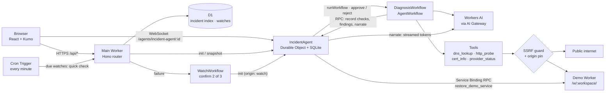

# Incident Copilot

An AI on-call assistant that runs entirely on Cloudflare. You describe a symptom in chat ("checkout.example.com is throwing errors"). An agent then picks which checks to run, runs them as durable Workflow steps and explains in plain English what's wrong, with every claim citing its evidence (`[http-1]`). It may propose a fix, and the fix runs only after you approve it.

It comes with a **demo service** you can break on purpose (500 errors, slowness, a redirect loop, bad caching), so the whole loop of break → diagnose → approve → verified → resolved can be tried in about a minute.

> **Live URL:** not published yet. The rate limits and the neuron budget guard (WP-17) are built and go live with the next deploy; the URL is shared after that (decision D2, see [Security](#security)).

- **Docs:** [`PRD.md`](PRD.md) (what and why), [`TDD.md`](TDD.md) (how, and every decision), [`TASKS.md`](TASKS.md) (the build board), [`PROMPTS.md`](PROMPTS.md) (how AI was used).

---

## 60-second walkthrough

1. Open the app. A workspace is created for you (an anonymous cookie, no sign-up).
2. Type `diagnose cloudflare.com`. Check cards fill in (DNS, then HTTP), and a healthy diagnosis streams in with evidence.
3. In the **Demo service** panel, switch on **500 errors**.
4. Ask "what's wrong with my demo service?". You get an `origin_5xx` diagnosis citing `[http-1]`, plus an approval card: **Restore the demo service to healthy**.
5. Click **Approve**. The demo is restored, a re-check passes, and the incident goes to `mitigated`, then to `resolved` after two more passing checks.
6. Click **Postmortem**. A markdown write-up appears, ready to copy: the impact window, detection and timeline come straight from the incident's records, and the AI writes the summary, root cause (with evidence IDs), resolution and follow-ups. It's stored on the incident.

A link to an incident opened by someone else is **view-only**: you can watch it live, but you can't send messages or approve anything.

## How it meets the assignment

| Requirement | Implementation |
|---|---|
| **LLM** | Workers AI `@cf/openai/gpt-oss-120b`, falling back to `@cf/zai-org/glm-4.7-flash`, both routed through **AI Gateway** (`incident-copilot`) for logs and fallback. A deterministic rule engine takes over when both are unavailable. |
| **Workflow / coordination** | **Workflows**: `DiagnosisWorkflow` (extends the Agents SDK's `AgentWorkflow`) runs each LLM turn and each check as its own durable, retryable step, then waits for human approval with `waitForApproval`. `WatchWorkflow` confirms a watched endpoint's failure (2 of 3 checks) before opening an incident on its own. |
| **User input** | A React chat UI (Cloudflare's Kumo design system) served by **Workers Static Assets**, with live updates over a WebSocket straight to the incident's Durable Object. **Voice:** a mic button records up to 30 s, Workers AI `whisper-large-v3-turbo` transcribes it, and spoken "dot" and "slash" become `.` and `/`. The text lands in the input box for you to check; it's never sent on its own. |
| **Memory / state** | **Durable Objects** via the Agents SDK: one `IncidentAgent` per incident with its own SQLite (checks, evidence, messages, approvals, timeline). **D1** holds the workspaces, the incident index per workspace (for the sidebar), the watchlist and the daily neuron count. |

Also used: Cron Triggers (the watchlist), Rate Limiting bindings, Service Bindings with RPC (main Worker → demo Worker), Workers Logs, and the `global_fetch_strictly_public` flag.

## Architecture



**One request, start to finish:**
1. `POST /api/incidents` parses the target from the message (a URL, then a hostname, then the word "demo"; no LLM involved), creates an `IncidentAgent` and calls `init`.
2. The agent records the question and starts a `DiagnosisWorkflow` with the ID `diag-<incident>-<run>`.
3. The Workflow runs the baseline checks (DNS + HTTP) right away, so the first card shows in about a second. Two more run only when they help: a certificate lookup in the CT logs (crt.sh, best effort) when HTTPS fails to connect, and the provider's status page (Cloudflare, GitHub, AWS) when a site hosted there is failing. It then gives the model the evidence digests and lets it either call more tools or call `submit_findings` (category, confidence, evidence IDs, actions), which is validated with zod.
4. The agent streams a narration of those fixed findings over the WebSocket. A citation check removes any sentence that cites an unknown ID, or makes a factual claim without a citation.
5. If an action is proposable, an approval card appears and the Workflow waits for it. On approve, the agent runs the action and re-checks it. It then checks again every 15 s, and resolves the incident once 3 checks in a row have passed (the re-check plus two more).

**Watching (WP-18):** a workspace can watch up to 3 URLs for 24 hours (30 across the app). A Cron Trigger runs every minute and quick-checks the watches that are due (every 5 minutes, or every minute for your own demo), with no LLM. When a check fails, a `WatchWorkflow` re-checks 30 s later. If it fails again (2 of 3), the Workflow opens an incident on its own, and the diagnosis is waiting when the user looks. Later passing checks move it to mitigated and then resolve it after 3 in a row. A broken real site also gets an "Add to watchlist" card, which links the new watch to that incident.

**Notifications (WP-19):** the sidebar polls the incident list every 10 s while the tab is visible. New activity (a diagnosis, or a status change the user didn't make) shows as an unread dot with the word "New", and raises a browser notification if the user turned them on. Opening the incident marks it read. A workspace can also save one Slack or Discord webhook. A `NotifyWorkflow` posts to it when a watched incident opens (after the diagnosis, so the message names the likely cause), starts recovering, and is resolved. Its instance ID `notify-<incident>-<event>` means each event posts at most once.

## How the Agents SDK is used

- **`Agent` (one per incident).** The SQLite tables are the source of truth. A small synced `IncidentState` is rebuilt from them and pushed to every connected client; clients can't write state. `onConnect` tags each connection as `owner` or `viewer` from the workspace cookie, and every mutating callable (`sendMessage`, `approve`, `reject`, `resolve`) checks for `owner`. The agent's scheduler (`this.schedule`) runs the monitor ticks after an action, so no Workflow sits idle for minutes.
- **`AgentWorkflow`.** `runWorkflow` starts a run with an ID derived from the run, so a retry can't start it twice. `waitForApproval` pauses durably until the agent calls `approveWorkflow`/`rejectWorkflow`, or the wait times out (the card then expires).
- **Thin agent, plain modules.** The planning loop is a pure function (`worker/loop/plan.ts`) that takes an `io` object, and the Workflow is a thin wrapper around it. Every limit and failure path is therefore unit-tested without a runtime, and an SDK upgrade only touches the wrapper.

## The agent loop and its limits

| Limit | Value |
|---|---|
| Planning turns | 3 (plus 1 narration turn) |
| Tool calls per run | 6 |
| Wall-clock deadline | 60 s |
| Subrequests per run | 45, reserved before each tool runs (the Free plan allows 50) |
| HTTP read cap / timeout | 16 KB / 10 s, redirects followed by hand (at most 5 hops) |
| Evidence sent to the LLM | a digest of at most 1.5 KB per check; the raw evidence stays in the Durable Object |

**Limits keep progress.** A run that hits any limit (turns, tools, deadline, budget, the LLM being down, or two invalid tool calls in a row) doesn't throw away what it has found. It finishes with the best diagnosis from the evidence so far: the model's valid fields are kept and the rule engine fills in the rest. The UI then says which limit ended the run.

**Failure categories:** `dns_failure`, `dns_mismatch`, `tls_expiry`, `origin_5xx`, `edge_error`, `high_latency`, `redirect_loop`, `cache_misconfiguration`, `provider_outage`, `healthy`, `inconclusive`. The 11 rules are in [`worker/diagnosis/classify.ts`](worker/diagnosis/classify.ts) (TDD §9.3).

## Security

The app fetches URLs that users type in, so it's built so that it can't be used as an open proxy or to reach private networks.

- **SSRF guard** ([`worker/safety/ssrf.ts`](worker/safety/ssrf.ts)):
  - only `http`/`https` on ports 80/443;
  - IP literals, `localhost`, `.local`, `.internal`, single-label hosts and URLs with credentials are refused;
  - the host is resolved over DoH first, and refused if **any** A/AAAA answer falls in a private, loopback, link-local, CGNAT, documentation, multicast or reserved range (IPv4 and IPv6, including IPv4-mapped, NAT64 and 6to4 forms);
  - every redirect hop is checked again;
  - `global_fetch_strictly_public` is on as a second layer.
- **Origin pin:** the tools only reach the incident's own host (and, for DNS and certificates, the CNAME targets found in that incident's evidence). `provider_status` only reads three fixed status pages. A different host needs a new incident.
- **Read-only probing:** GET/HEAD only, no user-supplied headers, bodies or cookies, and reads capped at 16 KB.
- **Prompt injection:** fetched content goes to the model inside `<untrusted>` tags and is truncated. The model's tool calls are checked with zod and against the origin pin. Actions come only from a fixed catalog, and every action needs a human's approval.
- **Incident links are view-only** for anyone but the workspace that owns them.
- **Rate limits and the budget guard (WP-17):** a workspace can start 3 diagnoses a minute (Rate Limiting binding) and 10 an hour (a D1 counter); new incidents and follow-ups both count, and a refusal is a 429 that says when to try again. Because dropping the cookie gives a new workspace, each visitor IP is also limited, to 6 a minute and 20 an hour (only a hash of the IP is stored). Probes are limited to 10 a minute per hostname, so the app can't be used to hammer a site; the app's own demo service is exempt, since every workspace's demo shares one hostname. Once today's estimated Workers AI use reaches 9,000 neurons (of the 10,000 free), new runs use the rule engine instead of the LLM and the header says so. These checks fail open: if the binding or D1 errors, the run goes ahead, and the LLM path still falls back to rules when Workers AI reports the daily allocation is used up.
- **Webhooks (WP-19):** only `https://hooks.slack.com/…` and `https://discord.com/api/webhooks/…` (or `discordapp.com`) are accepted. The URL is encrypted with AES-GCM using the `WEBHOOK_KEY` Worker secret, with the workspace ID as additional data, and is only ever shown masked. It's never logged and never sent to the LLM. Without the secret, webhooks are switched off.
- **The smoke flag:** `POST /api/incidents?smoke=rule` runs a diagnosis without the LLM, for the deploy check. It's public, but it can only make a run cheaper.

**Accepted risks:**
- **D2: the URL wasn't protected on Day 1.** Rate limits, quotas and the budget guard came in WP-17, so the `workers.dev` URL wasn't shared until they shipped. If it's ever abused, `LLM_MODE` can be set to `mock` on the deployed Worker. The Rate Limiting binding counts per Cloudflare location and is approximate; the D1 hourly quota is exact.
- **D7: the workspace ID is visible.** The demo lives at `/w/<workspaceId>/`, and that ID is also the session credential. It shows up in a public URL, in prompts and in logs. Someone who learns it can act as that anonymous workspace, which only holds that person's own incidents and demo.
- **One location.** Probes run from whichever Cloudflare location runs the Workflow, so the app doesn't claim anything about regional reachability.
- **DNS rebinding.** The guard checks DNS, then fetches, and the name could resolve differently in between. `global_fetch_strictly_public` narrows this, but it can't be closed completely from inside a Worker.

## Running it locally

You need Node 22+ and pnpm (the version is pinned in `package.json`, so `corepack enable` picks it up).

```sh
pnpm install
cp .dev.vars.example .dev.vars   # LLM_MODE=mock: no Cloudflare account and no neurons needed
pnpm dev                         # http://localhost:5173
```

- **Locally, the demo service runs inside the same dev server.** `.dev.vars` points `DEMO_BASE_URL` and the dev-only `SSRF_DEV_ALLOW_ORIGIN` at `http://localhost:5173`, so probes can reach it. Production never sets that variable.
- **To use the real models,** set `LLM_MODE=live` and run `wrangler login`. The AI binding is always remote, so live runs spend real neurons (about 140 per diagnosis).
- **The mock LLM** plays scripted turns that read the evidence. Putting `#llm-down` or `#llm-invalid` in a message triggers the fallback paths.

| Command | What it does |
|---|---|
| `pnpm typecheck` | `tsc -b` over the Worker, web and Node projects |
| `pnpm lint` | ESLint, with floating promises treated as errors |
| `pnpm test` | All three Vitest projects (below) |
| `pnpm build` | Builds the client and both Workers into `dist/` |
| `pnpm smoke <url>` | The deploy smoke test against any running copy |
| `pnpm eval --base <url>` | The LLM eval (below). Uses real neurons, so it isn't in CI |

## Tests

[`vitest.config.ts`](vitest.config.ts) defines three projects. None of them needs a login or the network.

- **`unit`** (Node): the SSRF tables, the target parser, the DNS/HTTP parsers, classification for every category, the citation check, the LLM adapter run on recorded responses, SSE parsing, the planning loop with every limit, transitions, and the web helpers.
- **`integration`** (`@cloudflare/vitest-plugin`, the real Workers runtime): the main Worker with `LLM_MODE=mock`, a **fake internet** Worker as the only outbound route (DoH and HTTP for `*.example.com`), and a stub demo Worker that records every `setModes` call. It covers the agent over a real WebSocket (owner and viewer), the API, real `DiagnosisWorkflow` runs, and the full approval path (approve → restore → verify → resolve, reject, expire, viewer, dedupe).
- **`demo`**: the real demo Worker, every mode.

**LLM eval** ([`eval/`](eval/), TDD §16): breaks the demo each way (`slow`, `errors`, `redirect_loop`, `bad_cache`) plus a `healthy` control, runs a real AI diagnosis, and scores the category, a citation of a real `http-*` check, and the proposed restore. A run that falls back to the rules fails. **Latest: 5/5** (target ≥ 4/5), 642 neurons; see [`eval/results.md`](eval/results.md).

## CI/CD

- **[`ci.yml`](.github/workflows/ci.yml)** runs on every PR into `main`: install with a frozen lockfile, typecheck, lint, test. The Terraform `fmt`/`validate` steps switch on once `infra/` exists.
- **[`deploy.yml`](.github/workflows/deploy.yml)** runs on every push to `main`. It re-runs CI, applies the D1 migrations, builds, and deploys the **demo Worker first** (the main Worker's Service Binding needs it to exist), then the main Worker. Last, it runs `scripts/smoke.ts` against the new URL: health, session, demo set to healthy, a rule-based diagnosis, and a check that it comes back `healthy`. The smoke test uses no neurons.
- **Secrets** (GitHub Actions): `CLOUDFLARE_API_TOKEN` (the "Edit Cloudflare Workers" template plus Account › D1 › Edit) and `CLOUDFLARE_ACCOUNT_ID`. Nothing else is needed.
- **Code review:** work happens on `dev`, and every `dev` → `main` PR is also reviewed by Sift (`sift-review.yml`).

**First deploy by hand** (TDD §15):
1. `wrangler d1 create incident-copilot`, then put its ID into `wrangler.jsonc`.
2. Create the AI Gateway `incident-copilot` in the dashboard.
3. `wrangler d1 migrations apply DB --remote`.
4. `pnpm build`, then `wrangler deploy -c dist/incident_copilot_demo/wrangler.json`.
5. Set `DEMO_BASE_URL` in `wrangler.jsonc` to the demo's URL.
6. `pnpm build`, then `wrangler deploy`.
7. For Slack/Discord webhooks, set the encryption key once: `openssl rand -base64 32 | npx wrangler secret put WEBHOOK_KEY`. Without it, webhooks stay off.

## Terraform and wrangler: who owns what

| Owner | Resources | Why |
|---|---|---|
| **Terraform** (planned, local state, D15) | Long-lived account resources: the D1 database, and the AI Gateway if the provider supports it | Created once and rarely changed |
| **wrangler** (`wrangler.jsonc`) | Worker code, every binding, Durable Object migrations, Workflows, Static Assets, D1 schema migrations | Changes with every deploy, and some bindings (Rate Limiting) exist only in wrangler |

Today, Terraform isn't built (WP-25, below the cut line). D1 was created with `wrangler d1 create`, and the AI Gateway in the dashboard (only a gateway named `default` is created automatically). Whether the Terraform provider can manage AI Gateway is still an open question (PRD R1). CI's Terraform steps switch on by themselves once `infra/*.tf` exists.

## Designed, not built (yet)

The full design for each of these is in the TDD. Day 2 of the build is still in progress, so items leave this list as they ship ([`TASKS.md`](TASKS.md) has live status).

| WP | Feature | Design |
|---|---|---|
| 24 | `recheck_burst`: re-check every minute for 15 minutes | TDD §8.4 |
| 25 | Terraform for D1 (and the AI Gateway if supported) | TDD §15 |
| 26 | Demo GIF of the walkthrough | — |

## Repository layout

```
worker/       main Worker: api/ (Hono routes), agent/ (IncidentAgent, state, transitions, monitor),
              workflows/ (DiagnosisWorkflow), loop/ (planning loop, budget, findings, narration),
              tools/, safety/ (SSRF, reader, origin pin, target parser), llm/, diagnosis/ (rules), actions/
web/          React client: components/, hooks/, lib/
demo-service/ the breakable demo Worker (modes, DemoState DO, DemoAdmin RPC)
migrations/   D1 schema
scripts/      smoke.ts
eval/         LLM eval: cases.ts (cases + scoring), run.ts, results.md
test/         unit/, integration/, demo/, fixtures/ (recorded LLM responses)
prompts/      full transcripts of the Claude Code sessions that built this
```

## How AI was used

The app was built in Claude Code sessions inside this repo, from planning (PRD, TDD) through to deploys. [`PROMPTS.md`](PROMPTS.md) has the key prompts by phase plus a log of every prompt, and [`prompts/`](prompts/) holds the full transcripts, with only secrets removed.
